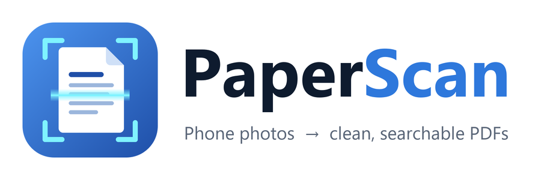
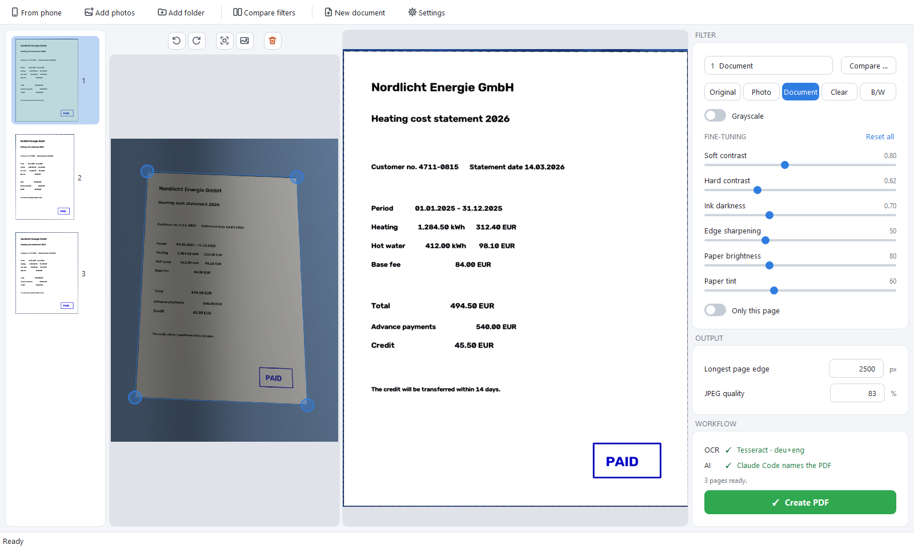
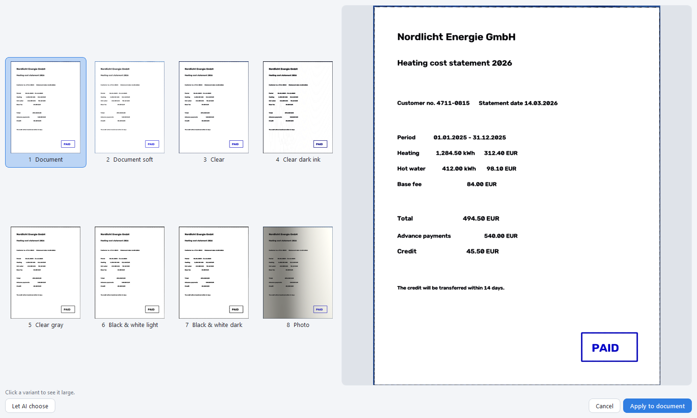
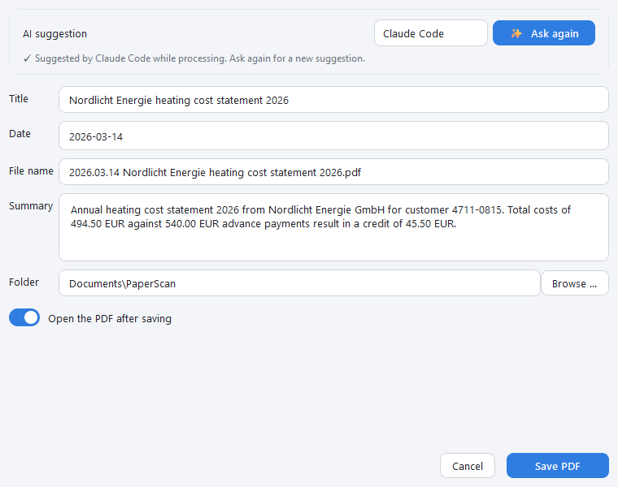
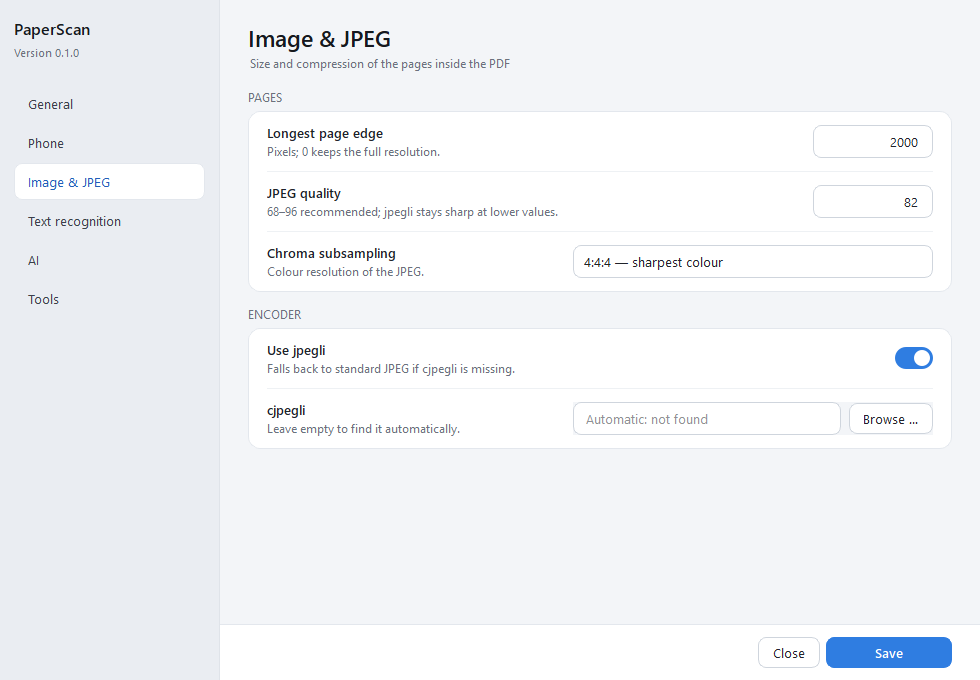

<p align="center">
    
</p>

<h3 align="center">Phone photos of paper → clean, searchable, well-named PDFs</h3>
<p align="center"><i>Desktop app and CLI · adaptive shadow removal · OCR text layer · AI file naming · runs locally</i></p>

---

<p align="center">
<a href="https://github.com/bjspi/PaperScan/actions/workflows/ci.yml">
    
</a>
<a href="https://github.com/bjspi/PaperScan/commits/main">
    
</a>


<a href="LICENSE">
    
</a>
<a href="https://github.com/astral-sh/ruff">
    
</a>


</p>

<p align="center">
  <a href="#-highlights"><b>Highlights</b></a>
  &nbsp;·&nbsp;
  <a href="#-screenshots"><b>Screenshots</b></a>
  &nbsp;·&nbsp;
  <a href="#%EF%B8%8F-installation"><b>Installation</b></a>
  &nbsp;·&nbsp;
  <a href="#%EF%B8%8F-desktop-app"><b>Desktop app</b></a>
  &nbsp;·&nbsp;
  <a href="#%EF%B8%8F-command-line"><b>CLI</b></a>
  &nbsp;·&nbsp;
  <a href="#-agent-workflow"><b>Agents</b></a>
  &nbsp;·&nbsp;
  <a href="#-how-it-works"><b>How it works</b></a>
  &nbsp;·&nbsp;
  <a href="#%EF%B8%8F-development"><b>Development</b></a>
</p>

---

Plug in your phone, pick the photos of that five-page heating bill, and get **one** clean PDF:
white paper instead of shadows, crisp text, a selectable text layer, and a file name like
`2026.03.14 Nordlicht Energie heating cost statement 2026.pdf` — with the date read from the
document itself. No scanner app, no cloud scanner service, no copying files around.

## ✨ Highlights

- 📱 **Phone, files or folders** — the newest camera photos over USB (ADB) with thumbnails, or over
  Wi-Fi (Wireless debugging) when no cable is plugged in; single files, whole folders or drag & drop. Several photos form one document; one photo works too.
- 🗂️ **Several documents in one go** — import a whole stack, right-click a page to start a new document
  with it (or split where photos were taken minutes apart), and save all PDFs from one dialog.
- 📐 **Finds the page** — neural border detection (optional) refined by OpenCV, perspective
  correction, corners *and* whole edges draggable, with a magnifier for pixel-exact corners.
- ☀️ **Adaptive cleanup** — paper turns white under sun, shadows and folds because the paper
  colour is estimated locally, block by block, instead of with one global threshold.
- 🎛️ **Presets and fine-tuning** — *Document*, *Clear*, *Black & white*, *Photo*, colour or gray,
  eight presets and every threshold as a slider (double-click resets).
- 🔍 **Compare filters** — all presets side by side, click to enlarge, or let an AI choose.
- 🖼️ **What you see is what you get** — the preview is rendered from the original photo at the
  output size, exactly like the PDF.
- 🗜️ **jpegli compression** — the encoder used by XnConvert; longest edge limited (e.g. 2000 px);
  no EXIF or GPS data in the output.
- 🔤 **Searchable PDF** — Tesseract text placed invisibly at the right positions: select, copy and
  search in PDF-XChange, Acrobat or any viewer.
- 🤖 **AI naming** — your local **Claude Code** or **Codex** CLI, or the OpenAI API, reads the
  pages and suggests title, document date, summary and keywords — automatically or on demand in
  the save dialog — and can correct OCR errors line by line.
- ✏️ **Your file names** — `2026.11.09 Title.pdf` (date style configurable), editable before
  saving; the chosen folder is remembered.
- 🧹 **Tidy phone** — optionally delete the imported photos from the phone once the PDF is saved
  (asks first; local copies are kept).
- ⌨️ **Fully scriptable** — every step as a `rich-click` CLI with JSON output, built for scripts
  and agents.
- 🧰 **Setup assistant** — installs Tesseract (with languages), cjpegli and adb on first start.

## 📸 Screenshots

<p align="center">
  <a href="docs/assets/main-window.png" target="_blank">
    
  </a>
  <br />
  <sub><b>🖥️ Main window</b> — Drag corners or whole edges on the left, see the export-quality page on the right, tune filter and output on the side, finish with <b>Create PDF</b>.</sub>
</p>

<p align="center">
  <a href="docs/assets/compare-filters.png" target="_blank">
    
  </a>
  <br />
  <sub><b>🔍 Compare filters</b> (Ctrl+K) — Numbered variants side by side, click to enlarge, <i>Let AI choose</i>, apply to the whole document.</sub>
</p>

<table>
  <tr>
    <td align="center" width="50%" valign="top">
      <a href="docs/assets/save-dialog.png" target="_blank">
        
      </a>
      <br />
      <sub><b>🤖 Save dialog</b> — Review the AI's title, date and summary; the file name stays editable and the folder is remembered.</sub>
    </td>
    <td align="center" width="50%" valign="top">
      <a href="docs/assets/settings.png" target="_blank">
        
      </a>
      <br />
      <sub><b>⚙️ Settings</b> — One window with a sidebar for phone, image &amp; JPEG, text recognition, AI and tools — shared with the CLI.</sub>
    </td>
  </tr>
</table>

## ⬇️ Installation

**Windows** — in PowerShell:

```powershell
irm https://raw.githubusercontent.com/bjspi/PaperScan/main/install.ps1 | iex
```

**macOS** — in Terminal:

```bash
curl -fsSL https://raw.githubusercontent.com/bjspi/PaperScan/main/install.sh | bash
```

The installer

1. clones the repository to `~/PaperScan` (or uses the clone it runs from),
2. finds Python 3.12/3.13 — through uv, the py launcher or PATH, and asks if there is none,
3. closes a running PaperScan of that folder on Windows (it asks first if pages are unsaved),
   creates `.venv` and installs the app with all extras,
4. adds a Start menu entry (with icon) and the `paperscan` command,
5. offers to install the external tools (Tesseract + languages, cjpegli, adb),
6. starts the app and keeps its window open for 10 seconds (any key closes it).

Options: `-NoStart`, `-SkipTools`, `-Python <path>` (`--no-start`, `--skip-tools` on macOS).
Running it again is safe; `git pull` and a rerun update the app.

<details>
<summary>Manual installation</summary>

```bash
pipx install "paperscan[all] @ git+https://github.com/bjspi/PaperScan"
pipx install "paperscan[all] @ git+https://github.com/bjspi/PaperScan@v0.2.2"   # a fixed release
paperscan setup      # Tesseract (+ languages), cjpegli, adb
paperscan doctor     # tools, model and connected phone
```

Extras: `ml` (neural border detection), `openai` (OpenAI backend), `heic` (iPhone photos).
</details>

<details>
<summary>Optional: neural border detection</summary>

No neural model ships with PaperScan; an OpenCV contour detector finds the page. If you have a
compatible TFLite corner model (224×224 RGB input, four normalised corners plus confidences),
add it with:

```bash
paperscan model import page_corners.tflite
```
</details>

## 🖥️ Desktop app

Start it from the Start menu, or with `paperscan`.

| Area | What you do there |
| --- | --- |
| Header | *From phone*, *Add photos*, *Add folder* (or drop files), *Compare filters*; on the right *New document*, *Settings* |
| Page strip | Thumbnails of all pages; drag to reorder, right-click for page actions and to start a new document (each document becomes its own PDF) |
| Page actions | Above the photo: rotate left/right (Ctrl+L / Ctrl+R), detect edges again (Ctrl+D), whole photo (Ctrl+Shift+D), remove page (Del) |
| Left view | The photo with the detected outline — drag corners or whole edges; a magnifier shows the spot |
| Right view | The page exactly as it will be exported |
| Filter | Preset, mode, gray, fine-tuning sliders; applies to all pages unless *Only this page* |
| Output | Longest page edge and JPEG quality, saved immediately |
| Workflow | Whether OCR and AI naming will run, page count, and the green **Create PDF** button (Ctrl+S) |

*Create PDF* processes all pages, then shows the save dialog: AI suggestion (or *Ask AI* on
demand), title, date, editable file name, summary, folder, *open after saving* and — for phone
imports — *delete the photos from the phone*. Settings live in one window with a sidebar and are
shared with the CLI in `~/.PaperScan/config.json`.

## ⌨️ Command line

```text
paperscan                         open the desktop app
paperscan scan PHOTOS…            photos → one PDF (or --each → one PDF per photo)
paperscan compare PHOTO           render filter variants + overview.jpg (--rate: AI picks)
paperscan phone list|pull         newest camera photos over ADB
paperscan phone connect|pair      find the phone (USB, then Wi-Fi) / pair over Wi-Fi once
paperscan setup                   install missing tools
paperscan doctor                  tools, model and connected phone
paperscan model import FILE       optional TFLite page corner model
paperscan config show|path        settings and log file locations
```

`scan` options: `--folder DIR`, `--phone N`, `--each`, `--delete-from-phone` (`-y` skips the
question), `--filter`, `--gray/--color`, `--variant N`, `--set FIELD=VALUE`, `--auto-filter`,
`--max-edge`, `--quality`, `--ocr/--no-ocr`, `--ai none|openai|claude_cli|codex_cli`, `--title`,
`--date`, `-o`, `--json`.

```bash
paperscan scan invoice.jpg
paperscan scan --phone 5 --filter clear --ai claude_cli --delete-from-phone
paperscan scan --folder ~/Scans/heating-bill --gray --json
```

Exit code 0 on success, 1 on failure, 2 on usage errors. Every command takes `--help`.

## 🤖 Agent workflow

Simulate thresholds, judge the results with vision, then run the batch:

```bash
# 1. Render a sweep (or the presets) for one representative page
paperscan compare page1.jpg --set mode=black_white --vary bw_threshold=120,140,160,180 --json
#    → variant-01.jpg … overview.jpg, and for every variant the exact "scan_arguments"

# 2. Look at overview.jpg yourself — or let the configured AI rate it
paperscan compare page1.jpg --rate --ai claude_cli

# 3. Process the whole document with the chosen arguments
paperscan scan page*.jpg --set mode=black_white --set bw_threshold=140 --ai claude_cli --json

# …or all in one step
paperscan scan page*.jpg --auto-filter --ai claude_cli
```

## 🧩 How it works

1. **Border detection** — a 224×224 corner model (if imported) proposes the outline; when an
   OpenCV contour agrees closely (IoU ≥ 0.96) the pixel-precise contour wins.
2. **Perspective correction** — the four corners are mapped to a straight rectangle.
3. **Background estimation** — the most frequent colour of each ~40 px block is the paper
   colour there; blocks outside the main paper area are filled from their neighbours, then the
   map is smoothed and scaled up.
4. **Tone mapping** — every pixel's difference to its local background goes through cosine
   curves: paper becomes white, ink stays dark, stamps keep their colour.
5. **jpegli + PDF** — pages are encoded with cjpegli and embedded unchanged; Tesseract lines are
   written as invisible text stretched to their boxes.
6. **AI** — one request per document with downscaled pages and numbered OCR lines returns
   title, date, summary, keywords and optional line corrections.

Details: [docs/ARCHITECTURE.md](docs/ARCHITECTURE.md) · roadmap: [docs/PLAN.md](docs/PLAN.md).

## 🔒 Privacy

Everything runs on your computer. Only the optional AI step sends downscaled page images and OCR
text — to OpenAI when you choose the API, or through the Claude Code / Codex CLI installed on your
machine. API keys are stored only in your settings file (or `OPENAI_API_KEY`). Logs stay in
`~/.PaperScan/logs` (one file per day, kept 14 days).

## 🛠️ Development

```bash
uv venv && uv pip install -e ".[all,dev]"
ruff check src tests && ruff format --check src tests
mypy src
pytest -n auto
```

The code is layered: `gui/` and `cli/` (presentation) → `pipeline`, `session`, `comparison`,
`settings` (application) → `imaging/`, `ocr/`, `export/`, `analysis/`, `capture/` (domain) →
`platform_tools`, `tool_setup`, `app_paths`, `app_logging` (platform). Tests need no external
tool, network or personal data. See [docs/ARCHITECTURE.md](docs/ARCHITECTURE.md).

## 🤝 Contributing

Bug reports, ideas and pull requests are welcome. Please run the checks from
[Development](#%EF%B8%8F-development) before opening a pull request — CI runs the same on Windows,
macOS and Linux. If PaperScan saves you a trip to the scanner, a ⭐ helps others find it.

## 📄 License

MIT — see [LICENSE](LICENSE).

### Third-party licenses

PaperScan's own code is MIT. Its releases contain only that code: pip installs the libraries
below, and the setup assistant downloads the external tools from their official sources on your
machine. Each keeps its own license.

| Component | Used for | License |
| --- | --- | --- |
| [PyMuPDF](https://github.com/pymupdf/PyMuPDF) | PDF with invisible text layer | AGPL-3.0 or commercial (Artifex) |
| [PySide6 / Qt](https://doc.qt.io/qtforpython-6/) | GUI | LGPL-3.0 |
| [OpenCV](https://opencv.org/) (`opencv-python`) | Page detection, perspective, filters | Apache-2.0 |
| [NumPy](https://numpy.org/) | Image arrays | BSD-3-Clause |
| [Pillow](https://python-pillow.org/) | Photo loading, EXIF, JPEG fallback | MIT-CMU |
| [rich-click](https://github.com/ewels/rich-click) | Command line | MIT |
| [LiteRT](https://ai.google.dev/edge/litert) (`ai-edge-litert`, extra `ml`) | Neural border detection | Apache-2.0 |
| [openai](https://github.com/openai/openai-python) (extra `openai`) | OpenAI backend | Apache-2.0 |
| [pillow-heif](https://github.com/bigcat88/pillow_heif) (extra `heic`) | iPhone photos | BSD-3-Clause |
| [Tesseract](https://github.com/tesseract-ocr/tesseract) and its language data | Text recognition | Apache-2.0 |
| [jpegli / libjxl](https://github.com/libjxl/libjxl) (`cjpegli`) | JPEG encoding | BSD-3-Clause |
| [Android platform-tools](https://developer.android.com/tools/releases/platform-tools) (`adb`) | Phone import | Android SDK terms (Google) |

**PyMuPDF is AGPL-3.0.** Using PaperScan as it is published here is fine. If you redistribute
PaperScan together with PyMuPDF, for example in a bundled build, or build a closed-source product
on it, the AGPL applies to that combination, unless you hold a commercial PyMuPDF license from
Artifex.

The optional page corner model is not part of PaperScan. You import a compatible TFLite model
yourself, and its license is yours to check.
