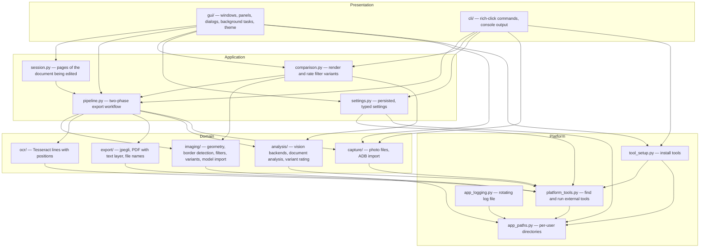

# Architecture

PaperScan turns phone photos of documents into searchable, well-named PDFs. It has two
front ends — a PySide6 desktop app and a rich-click CLI — on top of one Qt-free core.

## Layers

| Layer | Rules |
| --- | --- |
| Presentation | The only layer with Qt or console output. No image maths, no file formats. Slow work runs as background tasks. |
| Application | Orchestrates domain modules; owns progress, cancellation and the two export phases. Qt-free and unit-tested. |
| Domain | Pure functions and frozen dataclasses grouped by business domain. No Qt, no settings file access. |
| Platform | Everything OS-specific: tool lookup (incl. Homebrew and vendor install folders), subprocesses without console windows, downloads, paths, logging. |

Optional dependencies (`ai-edge-litert`, `openai`, `pillow-heif`) are imported once at module
level and degrade gracefully when missing; there are no function-local imports.

## Modules

### Domain

| Module | Responsibility |
| --- | --- |
| `imaging/geometry.py` | `Quad`, `Point`, `Rotation`; corner ordering, IoU, perspective warp, rotation, long-edge limit. |
| `imaging/border_detection.py` | Optional TFLite corner model + OpenCV contour search, combined by agreement. |
| `imaging/filters.py` | `FilterSettings`, `FilterMode`; background-normalising document filters, photo levels, black & white. |
| `imaging/filter_variants.py` | Presets, one-parameter sweeps, `field=value` text conversion, overview sheet. |
| `imaging/model_import.py` | Installs an optional `.tflite` page corner model. |
| `capture/photo_files.py` | Loading with EXIF orientation (and HEIC), capture time, folder listing, EXIF thumbnails. |
| `capture/adb_import.py` | `AdbClient`: list, read header bytes, thumbnail, pull and delete phone photos. |
| `ocr/recognition.py` | Tesseract TSV → `OcrLine`/`OcrPage`; fails loudly if no TSV comes back. |
| `export/jpeg_encoding.py` | cjpegli (jpegli) with a Pillow fallback; never writes metadata. |
| `export/pdf_builder.py` | One JPEG per page plus invisible text stretched to each line box. |
| `export/naming.py` | `FileDateStyle`, `<date> Title.pdf`, cleaning of typed names, unique paths. |
| `analysis/vision.py` | `ask_vision_json` for OpenAI, Claude Code CLI and Codex CLI; `available_providers`. |
| `analysis/document_analysis.py` | Prompt and parsing for title, date, summary, keywords, OCR line corrections. |
| `analysis/variant_rating.py` | Prompt and validation for choosing the best filter variant. |

### Application

| Module | Responsibility |
| --- | --- |
| `pipeline.py` | `open_page`, `flatten_page`, `render_page`; `prepare_export` → `ExportDraft` → `write_export`; `reanalyse` for AI on demand; `choice_for` builds names. |
| `session.py` | `DocumentSession`: ordered pages, shared vs. per-page filter, rotation, phone origins; quick and final-quality previews with a small full-photo cache. |
| `comparison.py` | Flattens a page once, renders all variants, rates them, writes files and the overview. |
| `settings.py` | `AppSettings` and sections, `ColorTheme`; JSON store; `normalized`, dotted get/set. |

### Presentation (GUI)

| Module | Responsibility |
| --- | --- |
| `gui/app.py` | Starts Qt (Fusion style, app icon, Windows taskbar identity, splash screen). |
| `gui/main_window.py` | Composition root of the GUI: wires panels to the session and runs background jobs. |
| `gui/page_strip.py` | Thumbnail column; drag to reorder; right-click menu. |
| `gui/page_toolbar.py` | `PageAction`s for the current page: icon bar above the editor, shortcuts, context menu. |
| `gui/corner_editor.py` | Draggable corners and edges, magnifier fed by the full-resolution photo. |
| `gui/filter_panel.py` | Presets, mode buttons, gray switch, fine-tuning sliders, page scope. |
| `gui/output_panel.py` | Longest page edge and JPEG quality, saved immediately. |
| `gui/workflow_panel.py` | OCR and AI status, page count, the Create PDF button. |
| `gui/export_dialog.py` | Review dialog: AI on demand, title, date, editable file name, folder, phone deletion. |
| `gui/compare_dialog.py` | Variant grid that opens at once and fills in when rendering finishes. |
| `gui/phone_dialog.py` | Phone photo grid with lazily loaded EXIF thumbnails and series preselection. |
| `gui/settings_window.py` | Sidebar settings declared as data (`SettingsPage` → `SettingsSection` → `SettingField`). |
| `gui/setup_panel.py` | Tool status badges and one-click installation. |
| `gui/setting_rows.py`, `toggle_switch.py`, `number_field.py`, `line_icons.py`, `image_view.py`, `images.py` | Reusable widgets and helpers. |
| `gui/theme.py` | Light/dark palettes and the style sheet. |
| `gui/tasks.py` | Thread-pool tasks that report back through signals. |

### Presentation (CLI)

`cli/main.py` defines the commands (`scan`, `compare`, `phone`, `setup`, `doctor`, `model`,
`config`; no command opens the GUI) and `cli/output.py` the banner, themes, tables and JSON output.

## Data flow

1. **Capture** — `AdbClient` lists phone photos, reads their EXIF thumbnails for the picker and
   pulls the chosen ones; local files and folders go straight in.
2. **Open** — `open_page` detects the outline: model (if imported) → precise contour when both
   agree → model alone → contour alone → whole photo.
3. **Edit** (GUI) — `DocumentSession` holds pages, the shared filter and a 1400 px working copy per
   page; the preview is first rendered from that copy, then from the original at output size.
4. **Prepare** — `prepare_export`: warp → rotate → limit edge → filter → jpegli → Tesseract lines;
   one AI request for the whole document if a provider is configured.
5. **Review** — title, date, file name, summary; *Ask AI* re-runs the analysis on the prepared
   draft with any available provider.
6. **Write** — `write_export` embeds the JPEGs and the text layer under the chosen file name;
   folder and *open after saving* are remembered; phone photos are deleted on request.

## Threading (GUI)

* Slow work runs on Qt's thread pool through `gui.tasks.start_task`; results arrive by signal on
  the main thread. Tasks receive frozen dataclass snapshots, never widgets.
* Running tasks stay referenced until their result is delivered; results arriving while the app
  shuts down are dropped and logged.
* Previews are debounced and tagged with a generation number, so stale renders are ignored and
  a quick render never replaces the final one.
* Export cancellation is a `threading.Event` checked between steps.

## Settings

* One JSON file, `~/.PaperScan/config.json`, shared by GUI and CLI; written atomically;
  unreadable files are renamed aside; unknown keys and wrong types fall back to defaults.
* Every value has its declared type (enums included). `normalized` re-applies the loader's type
  conversion to settings coming from widgets, because Qt returns enum members as plain strings.
* The settings window, the output panel and the save dialog edit the same values and keep each
  other in sync without overwriting unsaved edits elsewhere.

## Logging

`app_logging.setup_logging` (called once by the CLI entry point, which also starts the GUI)
writes INFO and above to `~/.PaperScan/logs/PaperScan.log`, rotated at midnight and
kept for 14 days. It records each workflow step — phone listing, copying and deleting, page
detection, per-page size and OCR line count, AI provider and response time, written PDF, saved
settings — and every failure with its traceback. The GUI shows failures in the status bar and
points to the log file.

## Design decisions

* **Background estimation per block.** The paper colour is the per-channel
  histogram mode of ~40 px blocks; non-paper blocks are filled from their nearest paper
  neighbours; the block map is blurred and scaled up as background. Pixels are mapped by their
  difference to that background through cosine tone curves — which is why sun and shadows do
  not matter.
* **OCR positions from Tesseract, text optionally from a vision model.** The model corrects
  numbered lines; boxes never move.
* **Tesseract TSV requested via `-c tessedit_create_tsv=1`**, because downloaded tessdata folders
  lack the `tsv` config file; output without a TSV header is an error, never an empty text layer.
* **No binaries or models in Git.** An optional model is imported at runtime; tools are
  installed by `tool_setup` into folders marked with `.nobackup`; local scratch material lives in
  the git-ignored `local_research/`.
* **Fusion style.** The native Windows 11 style paints combo box popups itself (black in light
  mode); Fusion draws everything through the style sheet on every platform.

## Testing

* `tests/test_imaging.py` — geometry, contour detection, filters on synthetic photos.
* `tests/test_documents.py` — OCR parsing and the TSV guard, AI answer parsing, file names and
  date styles, PDF text layer positions, settings persistence, ADB parsing, backup markers.
* `tests/test_variants.py` — presets, sweeps, text conversion round trip, overview, rating.
* `tests/test_workflow.py` — behaviour: photos → one PDF, cancellation, shared vs. per-page
  filters, reordering and rotation, phone photos marked for deletion.
* `tests/test_gui_settings.py` — the real settings window returns correctly typed settings.

No test needs Tesseract, adb, a model, network or personal data.
