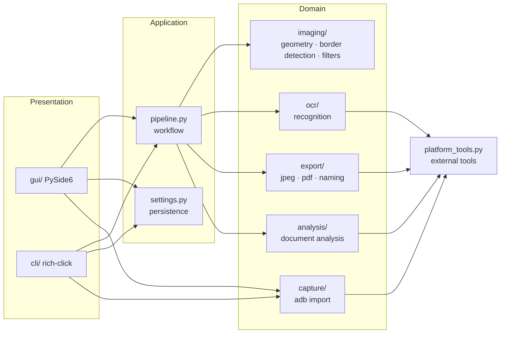

# PaperScan — complete plan

Turn phone photos of paper documents into clean, searchable, well-named PDFs,
without a scanner app on the phone. GUI for everyday use, CLI for automation
and agents. Windows and macOS.

## 1. Background

Scanner apps on the phone make each document a separate manual job: open the app, photograph,
crop, choose a filter, export, copy to the computer, rename. PaperScan moves that work to the
computer: photos are taken with the normal camera app and processed in batches, with full
control over cropping, filters, compression, OCR and file names, and everything is scriptable.

## 2. Requirements

| ID  | Requirement |
| --- | --- |
| R1  | Import the newest camera photos from an Android phone over ADB (photos stay on the phone), by USB or — as a fallback — Wireless debugging. Local files work too. |
| R2  | Several photos form **one document** (one PDF); a single photo is just the one-page case. All pages share one filter setting by default. One import can also be split into several documents (right-click: new document starting with this page, or split at capture pauses); every document becomes its own PDF, reviewed together in one save dialog. |
| R3  | Automatic page border detection that copes with real backgrounds; the user can correct every corner by hand. |
| R4  | Adaptive enhancement that copes with sun, shadows and folds (local background estimation). |
| R5  | Filters Original, Photo, Document, Clear and Black & white; colour/gray; all thresholds exposed as sliders. |
| R6  | Pages limited to a configurable longest edge (e.g. 2000 px). |
| R7  | JPEG with jpegli (as in XnConvert), configurable quality, no EXIF/GPS metadata. |
| R8  | One PDF per document with an invisible OCR text layer at the right positions (selectable in PDF-XChange). |
| R9  | AI analysis via OpenAI API, local Claude Code CLI or local Codex CLI: title, document date (e.g. invoice date, else capture date), short summary, keywords. Optional AI correction of the OCR text, positions stay Tesseract's. |
| R10 | File name `YYYY-MM-DD Title.pdf`, at most 200 characters, user can edit before saving. |
| R11 | All settings persist (output folder, max edge, JPEG, filters, OCR, AI, phone). |
| R12 | Clean, modern GUI (settings window with sidebar pages and setting rows); PySide6. |
| R13 | Complete rich-click CLI with ASCII header, JSON output for scripts and agents. |
| R14 | Runs on Windows and macOS. |
| R15 | Public repository quality: clean layered, domain-driven architecture; no credentials, no personal data, no third-party assets in Git. |
| R16 | Sources are equal: single photo, several photos, a local folder, or the phone — in GUI and CLI. |
| R18 | Filter comparison: render several variants (presets or a threshold sweep), show them numbered side by side, let a vision model rate them, apply the choice — in the GUI and fully scriptable by agents via CLI (`compare`, `scan --variant/--set/--auto-filter`). |
| R17 | Missing external tools (Tesseract, cjpegli, adb) are offered for installation on first start and via `setup`; no binaries in Git. |

## 3. Architecture



| Layer | Rules |
| --- | --- |
| Presentation (`gui/`, `cli/`) | Only layer that talks to the user. No image maths. GUI work runs in worker threads; Qt objects stay on the main thread. |
| Application (`pipeline.py`, `settings.py`) | Orchestrates the domain modules; owns cancellation and progress. Two-phase export (prepare → review → write). |
| Domain (`imaging`, `ocr`, `export`, `analysis`, `capture`) | Pure, testable functions and frozen dataclasses. No Qt. |
| Platform (`platform_tools.py`) | Finds and runs external tools (adb, tesseract, cjpegli, claude, codex) incl. Homebrew paths on macOS. |

### Data flow

1. `capture.adb_import` lists/pulls photos → local import folder.
2. `pipeline.open_page`: load (EXIF orientation), `imaging.border_detection`
   (TFLite model → OpenCV contour refinement → fallback full image), default filter.
3. GUI: user drags corners, rotates, adjusts the shared filter, reorders pages.
4. `pipeline.prepare_export`: per page warp → rotate → limit edge → filter →
   jpegli JPEG → Tesseract lines; then one AI request for the whole document.
5. GUI shows the suggestion (title, date, summary); user confirms.
6. `pipeline.write_export`: PDF with JPEGs + invisible text, metadata, unique file name.

## 4. Key design decisions

* **Positions from Tesseract, text optionally from a vision model.** Vision
  models cannot return reliable pixel boxes; they correct numbered Tesseract
  lines instead, so the text layer stays aligned.
* **Background estimation per block** instead of a global threshold — the
  reason it is robust against sun and shadows.
* **No model bundled.** `paperscan model import <file.tflite>` installs an optional one into
  `~/.PaperScan/models`; without it the OpenCV detector is used.
* **Settings as JSON in `~/.PaperScan/config.json`**, shared by GUI and
  CLI; atomic writes; unreadable files are set aside, never overwritten. API
  keys live only there (or in `OPENAI_API_KEY`), never in the repository.
* **No PyInstaller bundle.** Install with pipx/uv from Git; external tools via
  scoop (Windows) or Homebrew (macOS).

## 5. GUI

* **Main window**
  * Header bar (app icon and name) with icons: *From phone*, *Add photos*, *Add folder*,
    *Compare filters*; *New document* and *Settings* set apart on the right.
  * Left: page strip with thumbnails and document headers, drag & drop to reorder, right-click menu
    (page actions, new document starting with this page, join with previous, split at pauses);
    each document sits on its own tinted area.
  * Centre (40 %): page actions above the photo (rotate, detect edges, whole photo, remove),
    corner editor with draggable corners and edges and a magnifier.
  * Centre (60 %): the page exactly as exported (quick preview first, then from the original).
  * Right: filter panel (presets, mode, gray, fine-tuning sliders, *Only this page*), output
    panel (longest edge, JPEG quality) and workflow panel (OCR/AI status, *Create PDF*).
  * Status bar: message, slim progress bar, *Cancel*; errors show their message.
* **Phone import dialog**: newest photos as a thumbnail grid (EXIF thumbnails), latest series
  preselected, loading indicator; imported in capture order.
* **Compare dialog**: opens at once, fills in eight presets, AI rating, apply to the document.
* **Save dialog**: AI suggestion (automatic or *Ask AI*), title, date, editable file name,
  summary, remembered folder, *open after saving*, *delete from phone*.
* **Settings window** (sidebar, cards, switches): General, Phone, Image &
  JPEG, Text recognition, AI, Tools.
* Light/dark theme following the system; Fusion style on every platform; splash screen and icon.

## 6. CLI

```
paperscan                     # opens the GUI
paperscan scan a.jpg b.jpg --filter clear --ai claude_cli
paperscan scan --phone 5 --gray --json
paperscan phone list|pull|connect|pair
paperscan model import page_corners.tflite
paperscan config show|path
paperscan doctor
```

## 7. Phases and status

| Phase | Content | Status |
| --- | --- | --- |
| 1 | Domain: geometry, border detection, filters, ADB import, OCR lines, jpegli, PDF builder, naming, AI analysis | done, verified on real photos |
| 2 | Application: settings store, two-phase pipeline, session, comparison | done |
| 3 | CLI with banner: scan, compare, phone, setup, doctor, model, config | done |
| 4 | GUI: main window, corner editor (edges + magnifier), filter/output/workflow panels, phone, compare, save and settings dialogs, theme, icons | done |
| 5 | Quality gate: ruff, mypy, 87 tests (domain, settings, workflow, phone connection, multiple documents, GUI) | done |
| 6 | Docs: README with screenshots, ARCHITECTURE, PLAN | done |
| 7 | Setup assistant (`setup`, Tools page) and installers (`install.ps1`, `install.sh`) | done (Windows tested) |
| 8 | Filter comparison: `compare`, `--variant/--set/--auto-filter`, GUI dialog, AI rating | done |
| 9 | AI naming on demand, editable file names with date style, phone deletion, rotating log | done |
| 10 | First commit, GitHub repository, CI (ruff, mypy, pytest on Windows and macOS), tag-driven GitHub releases with wheel and sdist | done |
| 11 | macOS test run of GUI, installer and setup assistant on a real Mac | open |
| 12 | Hands-on check of edge dragging, magnifier and `scan --auto-filter` | open |
| 13 | Optional page-curl dewarping for bent pages and book spreads (e.g. a UVDoc/DocTr-style model, imported like the corner model). Perspective correction exists; phone cameras already correct lens distortion. | open |
| 14 | Wi-Fi fallback for the phone (Wireless debugging, pairing, search dialog that retries) | done (0.2.0) |
| 15 | Several documents from one import: split in the page strip, one save dialog for all PDFs | done (0.2.1) |
| 16 | Review of the whole history by a second reviewer; confirmed everyday problems fixed (phone deletion and import, downloads, Unicode text layer, unsaved pages, background saving) | done (0.3.0) |

## 8. Risks and open points

* Tesseract quality on poor photos — mitigated by the optional AI correction.
* macOS: PySide6 and all tools are available via pip/Homebrew; the GUI is not
  yet tested on a Mac.
* Phone deletion removes the file and its MediaStore entry; whether every gallery app
  drops its cached entry is not verified.
* No neural corner model ships with the project; detection then relies on the OpenCV contour
  search, which needs some contrast between page and background.
